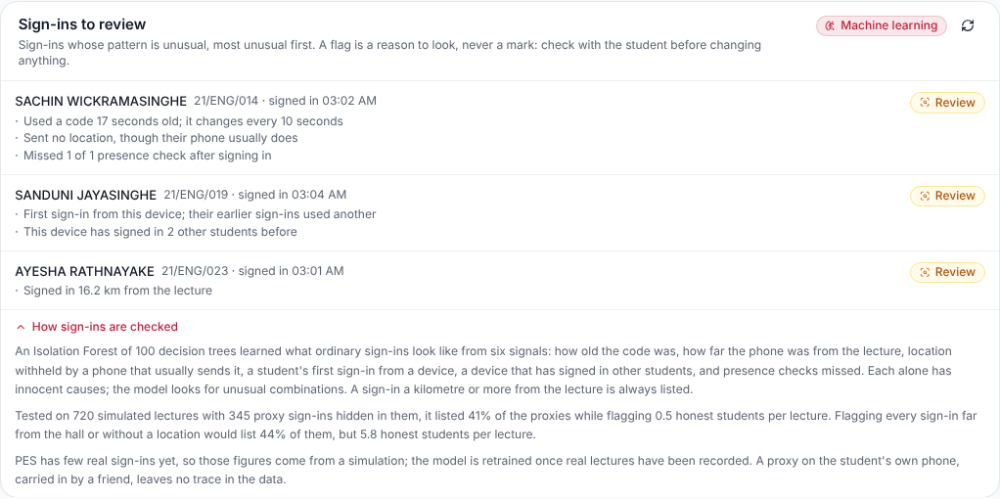
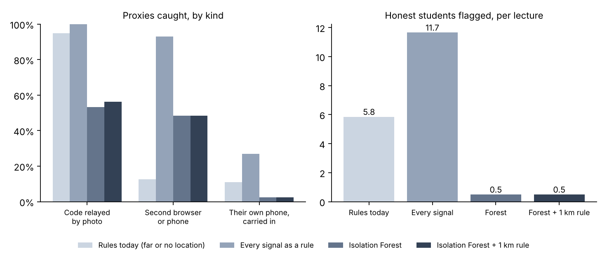
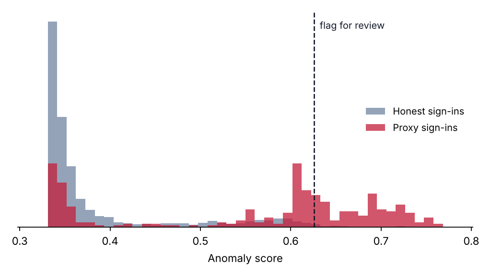

# 1. What it does

## 1.1 The problem

A live register puts a rotating code on the projector, and students sign in by scanning it. The code changes every ten seconds, a phone may sign in only one student per lecture, and the phone's distance from the lecturer is recorded. Those rules stop the easy tricks. They do not stop all of them:

- **A code relayed by photo.** A friend in the hall sends a photo of the code, and the absent student scans it from home before it expires.
- **A second browser or phone.** A friend signs themselves in, then signs the absent student in from a private window, which counts as a new device, or from a spare phone.
- **The student's own phone, carried in.** A friend brings the absent student's phone and signs in on it.

Each leaves traces, but every trace also has an innocent cause. Indoor GPS can be hundreds of metres out. Some students never allow location. Phones get replaced and browsers get cleared. People miss a presence check with their phone in a bag. A rule on any one signal either misses most proxies or buries the lecturer in false alarms.

## 1.2 What the lecturer sees

Under the sign-in register on the Attendance page, a **Sign-ins to review** card lists the lecture's unusual sign-ins, most unusual first. Each one says what was unusual, in plain words. A sign-in a kilometre or more from the lecture is always listed. When nothing stands out, the card says so in one line.



:::why WHY A FLAG IS NEVER A MARK
A flat battery, a new phone and a friend's private window can look alike in the data. So the card only lists sign-ins to look at, and says to check with the student before changing anything. Nothing in this feature changes attendance. The lecturer still marks the register, as before.
:::

# 2. The signals

## 2.1 Six numbers per sign-in

The database computes six numbers for every sign-in to a lecture, from what it already records. "Earlier" means lectures that opened before this one, so scoring a past lecture again gives the same answer.

<!-- widths: 28,72 -->
| Signal | What it is |
|---|---|
| Age of the code | How old the code was when it was used, in rotations (0 to 2; anything older is refused). A photo relayed from the hall arrives late. |
| Distance from the hall | ln(1 + distance / the register's radius), so 0 inside the hall and growing slowly with distance. 0 when there is no location. |
| Location withheld, unusually | When the sign-in sent no location: the share of the student's earlier sign-ins that did send one. A phone that never shares location is not flagged for it every week. |
| First sign-in from a device | 1 when a student with at least two earlier sign-ins has never used this device before. A new phone triggers it once, not every lecture after. |
| Device used by others | How many other students this device has signed in before (up to 3). |
| Presence checks missed | The share of the surprise presence checks after the sign-in that the student did not answer. Answering must come from the same device, so a phone that left the room cannot answer. |

Nothing personal is a signal: not who the student is, where they live or which phone they own. A device is a random identifier stored by the browser, not a fingerprint.

## 2.2 Two signals that were changed after the first test

The first version used a share of earlier sign-ins on another device, and a plain "no location" flag. Both produced streams of honest false alarms. After a phone change, the share stayed high for many lectures. A student who never shares location was flagged in every lecture. The current definitions above fixed both. Distance was first capped at 5 times the radius, which piled every remote sign-in onto one value. A dense pile looks normal to an Isolation Forest, so the scale became logarithmic.

# 3. The model

## 3.1 An Isolation Forest

An Isolation Forest builds many random decision trees. Each splits the data on a random signal at a random value, again and again, until every sign-in sits alone. An ordinary sign-in, deep in the crowd, takes many splits to isolate. An unusual one is cut off in a few. The score is how quickly a sign-in is isolated on average across the trees: from 0 to 1, higher meaning more unusual.

It is **unsupervised**. It learns what normal looks like and needs no examples labelled "proxy". PES will never have such labels in quantity, because a proxy that is caught is rarely recorded as one. The deployed forest has 100 trees, each built on 512 sign-ins.

## 3.2 The threshold, and one rule beside it

A sign-in is listed when its score is at least **0.626**. That level was set on separate validation lectures, so that about 1.5% of honest sign-ins (about one every two lectures) are listed.

The forest ranks one signal far off the scale about as unusual as two mild signals together. The first real sign-in scored showed this: it was made 16.2 km from its lecture, with nothing else unusual, and landed exactly at the threshold. No hall is that big, and indoor GPS errs by a few hundred metres at most. So a sign-in **1 km or more** from the lecture is always listed, whatever its score. The evaluation below includes the rule.

# 4. Why a simulation, and what it assumed

PES has recorded only a handful of live sign-ins so far, so there is nothing real to learn from or to test on. `ml/attendance_anomaly.py` therefore simulates whole semesters of lectures, injects proxy sign-ins into them, and measures how many are caught. The project plan proposed exactly this.

<!-- widths: 40,60 -->
| Assumption | Value |
|---|---|
| Class size, lectures | 25 to 60 students; 30 lectures a semester |
| How often a student attends | Each student differently, about 80% on average |
| Location | 12% of students never share it; a sharing phone slips 4% of the time |
| Indoor GPS | Within about 25 m of the lecturer, with a 100 to 600 m jump 5% of the time |
| Scanning | Within the current code, plus about 1 s delay; 6% catch the code as it changes |
| Phones | 1.5% of lectures, a student's phone or browser is new from then on; 0.4%, a friend's phone is borrowed |
| Presence checks | In 40% of lectures; an honest student answers 93% of the time |
| Proxies | 6% of absences; 40% relayed photos, 40% second browser or phone, 20% the student's own phone |

The training script mirrors the database's feature definitions line for line, so the same model scores real sign-ins.

:::warn WHAT THE SIMULATION CAN AND CANNOT SHOW
It shows that the method works under these assumptions: that the signals separate proxies from honest sign-ins, and at what cost in false alarms. It cannot say how often students really cheat, or whether real behaviour matches the assumptions. Once a semester of real sign-ins exists, retrain on them (section 7) and compare the flags with what lecturers find.
:::

# 5. How well it works

## 5.1 Against the obvious alternatives

Trained on 7,447 simulated sign-ins; threshold set on 6,362 more; tested on 23,052 sign-ins in 720 lectures it never saw, 345 of them proxies.

<!-- widths: 30,14,14,14,14,14 -->
| Approach | Proxies caught | Flags that were proxies | Honest students flagged per lecture | Photo relayed | Second device |
|---|---|---|---|---|---|
| Rules today (far, or no location) | 44% | 4% | 5.8 | 95% | 13% |
| Every signal as its own rule | 80% | 3% | 11.7 | 100% | 93% |
| Isolation Forest | 39% | 28% | 0.5 | 53% | 48% |
| **Isolation Forest + 1 km rule (deployed)** | **41%** | **29%** | **0.5** | **56%** | **48%** |



## 5.2 Reading them honestly

- **The point is the false alarms.** Today's location rules catch about as many proxies, but list nearly six honest students in every lecture. Only 1 flag in 25 is real, so a lecturer would soon stop reading them. The model lists one honest student every two lectures, and more than a quarter of its flags are proxies.
- **Every signal as a rule catches the most and is useless.** Twelve honest students a lecture would bury the few real cases.
- **Relayed photos are caught mostly when they come from far away.** The 1 km rule catches every sign-in made more than a kilometre from the lecture. A photo scanned from home with location withheld, by a student who usually withholds it, looks like an ordinary sign-in.
- **The student's own phone, carried in, cannot be caught.** The right phone, in the room, answering checks: no data can tell. It is in the test so the recall is honest.
- **AUC 0.82.** Ranked by score, a random proxy is placed above a random honest sign-in 82% of the time.

{width=80%}

# 6. In the database

## 6.1 Storage

The forest is stored as a model row in `ml_models` (name `attendance-anomaly-forest`, with the threshold, the 1 km limit and the evaluation) and 100 rows in `ml_isolation_trees`, one per tree, as parallel arrays: the signal tested at each node, the split value, the two children, and how many training sign-ins reached the node. Row Level Security is on with no policy, and table access is revoked: nothing reads the trees directly.

## 6.2 Functions

<!-- widths: 34,66 -->
| Function | What it does, and who may call it |
|---|---|
| `ml_checkin_features(session)` | The six numbers for every sign-in to a lecture. Internal. |
| `ml_isolation_score(model, x)` | Walks every tree to a leaf and turns the average path length into a score, exactly as scikit-learn does. Internal. |
| `ml_avg_path_length(n)` | The normaliser in the score. Internal. |
| `ml_checkin_review(session)` | Scores a lecture's sign-ins with the active model, applies the threshold and the 1 km rule, and writes the reasons. Internal. |
| `get_checkin_review(offering, date)` | The flagged sign-ins of a course on a date, most unusual first. Only the staff who may read that course's register: its assigned lecturers, its head of department, its department admin, the super admin. A former lecturer of the course is refused. |
| `ml_load_anomaly_model(token, payload)` | The loader, with the same single-use tokens as the grade predictions. |

:::why WHY THE LOADER CHECKS ITS OWN WORK
A forest scored differently in the database than in Python would be silently wrong. So the payload carries 40 sample sign-ins with the scores scikit-learn gave them. The loader scores them with the trees it has just stored, and refuses the whole load, keeping nothing, unless every score matches to six decimal places. Every load so far has matched all 40.
:::

## 6.3 Tested

As the assigned lecturer, a former lecturer, a student and a signed-out caller, in rolled-back transactions:

- The lecturer saw the 16.2 km sign-in listed with its reason. The other real sign-in, 268 m away with a slightly old code, was correctly not listed.
- The former lecturer and the student were refused ("Only the staff of this course can review its sign-ins").
- Signed-out callers, and everyone else for the internal functions and the trees table, got "permission denied".

# 7. Retraining with real lectures

Once a semester of live registers has been recorded:

```
# 1. In the Supabase SQL editor, run ml/export_checkins.sql and save the
#    cell as ml/data/checkins.csv: six numbers per sign-in, nothing else.

# 2. Train on the simulation plus the real sign-ins, and evaluate.
python ml/attendance_anomaly.py --real ml/data/checkins.csv

# 3. Load, with a single-use token.
python ml/load_predictions.py --new-token
ML_LOAD_TOKEN=<token> python ml/load_predictions.py --anomaly
```

A load replaces the active model; earlier ones stay in `ml_models`, inactive. Commit the new `ml/report/attendance/`.

# 8. Limits, and what would make it better

<!-- widths: 34,66 -->
| Limit or next step | Why |
|---|---|
| Real data | Every figure here is from a simulation. The first real semester is the real test. |
| Lecturer feedback | A "this was fine" or "this was a proxy" button on each flag would give PES its first labels, and a way to measure precision for real. |
| Per-room radius | One 250 m radius fits all halls; a radius per lecture room would sharpen the distance signal. |
| Timing between sign-ins | A second device used by the same friend often signs in seconds after them; pairs of sign-ins close in time and place are a signal not yet used. |
| Own phone, carried in | Undetectable from sign-in data. Only presence checks at unpredictable moments, or a headcount, can catch it. |

# 9. Words used in this guide

<!-- widths: 28,72 -->
| Word | Meaning |
|---|---|
| Proxy sign-in | A sign-in made for a student who is not in the lecture. |
| Anomaly score | How unusual a sign-in is, from 0 to 1; higher is more unusual. |
| Isolation Forest | Random trees that cut the data until each point is alone; unusual points are cut off sooner. |
| Unsupervised | Learning what normal looks like without examples labelled right or wrong. |
| Threshold | The score at or above which a sign-in is listed. |
| Precision | The share of listed sign-ins that were proxies. |
| Recall | The share of proxies that were listed. |
| AUC | How well the score ranks proxies above honest sign-ins; 0.5 is chance, 1.0 is perfect. |
