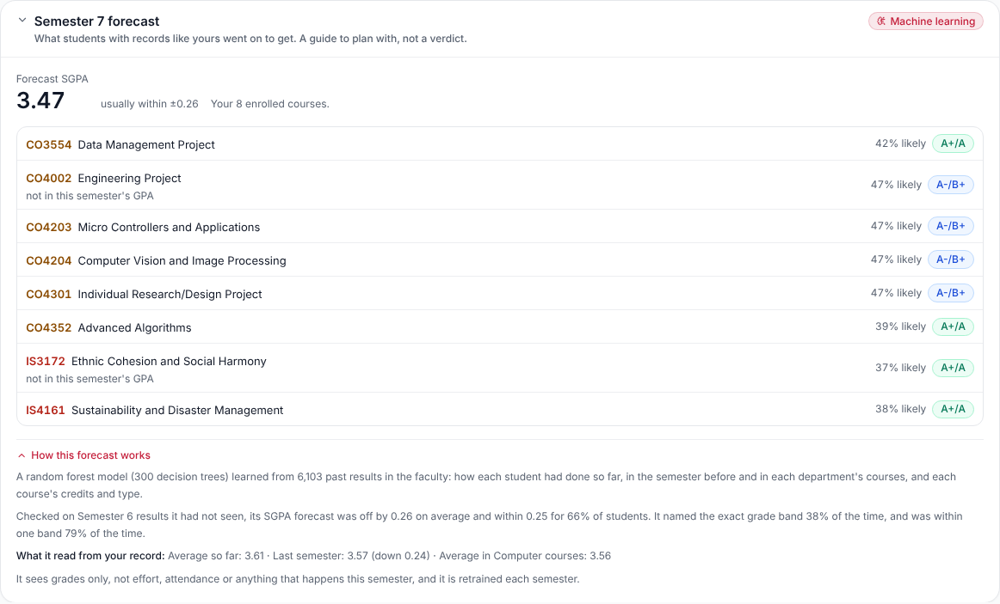
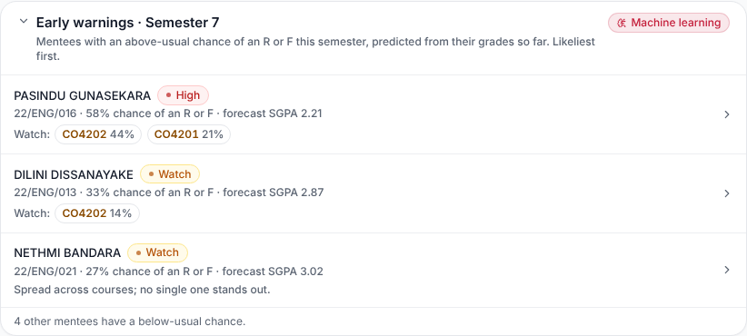
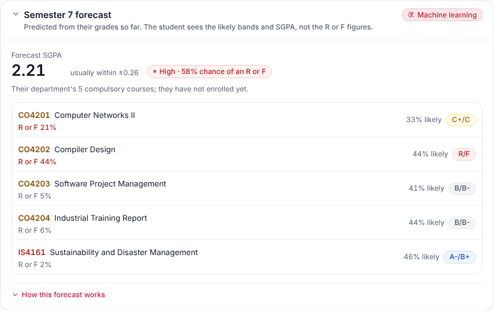
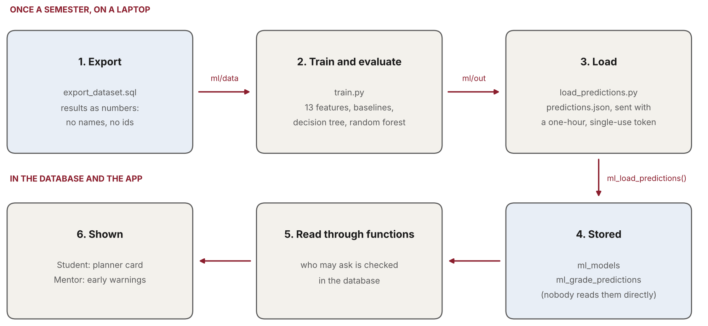
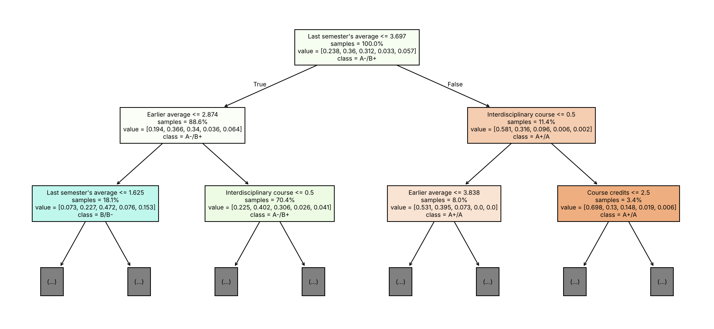
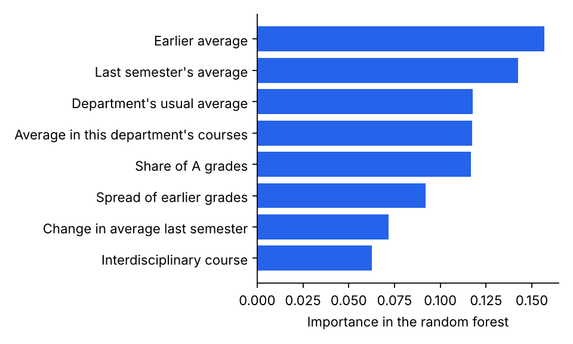
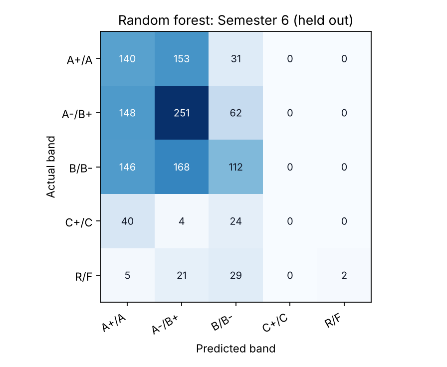
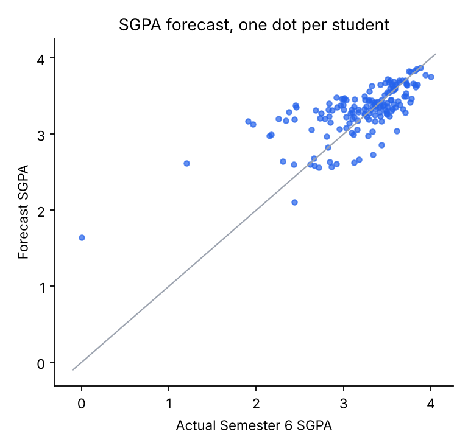

# 1. What it does

## 1.1 The question it answers

A student starting a semester wants to know how it is likely to go. A mentor wants to know which mentees need a conversation now, before the results are out. Both questions have the same answer underneath: for each student and each course this semester, which grade is likely?

PES answers it with a model trained on the faculty's own past results. For every student and every course of the coming semester it predicts the chance of each of five grade bands:

<!-- widths: 18,30,52 -->
| Band | Grades | Grade points |
|---|---|---|
| A+/A | A+, A | 4.0 |
| A-/B+ | A-, B+ | 3.7, 3.3 |
| B/B- | B, B- | 3.0, 2.7 |
| C+/C | C+, C | 2.3, 2.0 |
| R/F | R, F | 0 |

From those chances come three things people see: the **likely band** of each course, a **forecast SGPA** for the semester, and the **chance of at least one R or F**.

Bands rather than exact grades, as the proposal set out. Eleven grades are too many classes for a few thousand results, and neighbouring grades (B+ and A-) are often a matter of a mark or two. Five bands are what a student or mentor would act on anyway. L (a deferral after an approved medical) is not a result, so it is neither predicted nor counted.

## 1.2 Who sees what

<!-- widths: 18,30,52 -->
| Who | Where | What they see |
|---|---|---|
| Student | Graduation Planner, Current Standing | The likely band and how likely it is for each course, and the forecast SGPA with its usual error. No R or F figures (section 6.4). |
| Mentor | Academic Mentoring | An Early warnings card listing mentees with an above-usual chance of an R or F, likeliest first, with the courses to watch. Each mentee's page also carries their full forecast. |
| Head of department, department admin, super admin | Through `get_student_grade_forecast` | A student's full forecast, for anyone who may already see that student's record. |



{width=85%}

{width=85%}

## 1.3 The pipeline

The model is not trained inside the app. Training needs Python libraries the browser and the database do not have, and it only has to happen once a semester, when a semester's results are complete. So the work is split in two.



<!-- widths: 26,74 -->
| Step | What happens |
|---|---|
| 1. Export | `ml/export_dataset.sql` turns the results into anonymous numbers: student 1, course 57, grade B+. No id, name or index number leaves the database. |
| 2. Train | `ml/train.py` builds the features, tests every model on semesters it never saw, writes the report and charts, trains the final model and predicts the coming semester. |
| 3. Load | `ml/load_predictions.py` sends the predictions to the database, with a one-hour, single-use token instead of a secret key. |
| 4. Store | `ml_load_predictions()` turns the numbers back into students and courses and stores the predictions. |
| 5–6. Read and show | The planner card and the mentor cards call three database functions, each of which decides who may ask. |

# 2. The data

## 2.1 What the model learns from

<!-- widths: 46,54 -->
| What | How many |
|---|---|
| Published results | 7,392 |
| Students (all one batch) | 167, of whom 166 have results |
| Courses in the catalogue | 232 |
| Semesters with results | 1 to 6 |
| Results the final model is trained on | 6,103 (Semesters 2 to 6, deferrals left out) |
| Predictions made for Semester 7 | 2,062, for 166 students |

Semester 1 results are used only as history: a Semester 1 grade has no earlier record to predict it from. The final count is lower than the total because Semester 1 and the L grades are not training rows.

## 2.2 What leaves the database, and what does not

The export (`ml/export_dataset.sql`) writes four small text files into `ml/data/`:

<!-- widths: 26,74 -->
| File | Holds |
|---|---|
| `courses.txt` | For each course: its number, department, semester, credits, category (compulsory, elective, optional) and whether it counts towards the GPA. |
| `students.txt` | For each student: their number and department. Nothing else. |
| `results.txt` | For each student, their grades as course numbers and grade codes. |
| `fingerprint.json` | A checksum of the student list and of the course list the numbers came from. |

Students and courses are numbered 1, 2, 3 in the order of their database ids, so the numbering can be rebuilt inside the database later without the ids ever leaving it. `ml/data/` and the predictions in `ml/out/` are git-ignored: they stay on the machine that trains the model.

:::why WHY THE FINGERPRINT
The numbers only mean something while the lists they came from are unchanged. If a student were added after the export, everyone after them would shift by one, and a prediction meant for one student would be stored against another. So the loader recomputes both checksums and refuses the load if either differs: export again, train again.
:::

# 3. The features

## 3.1 Only what was known before the semester

Each training row is one result: one student, one course, one grade. Its features are worked out only from the student's record *before* that semester. A model that saw the semester's own grades would look brilliant in testing and be useless in practice, because when it predicts for real those grades do not exist yet. This mistake is called leakage, and the whole design avoids it.

<!-- widths: 30,70 -->
| Feature | What it is |
|---|---|
| Earlier average | The credit-weighted grade-point average of every earlier GPA course. |
| Last semester's average | The same, for the semester just before. |
| Change in average | Last semester's average minus the one before it: is the student rising or falling? |
| Average in this department's courses | The student's earlier average in courses of the same department as this course. |
| Spread of earlier grades | How uneven their grades are (standard deviation of grade points). |
| Earlier R or F grades | How many they have had. |
| Earlier deferrals | How many L grades. |
| Share of A grades | The share of earlier grades that were A-, A or A+. |
| Course credits | This course's credits. |
| Elective course | Whether it is elective or optional. |
| Own department's course | Whether it belongs to the student's own department. |
| Interdisciplinary course | Whether it is an IS course. |
| Department's usual average | Everyone's earlier average in this department's courses, a rough measure of how hard its courses are graded. |

No personal detail is a feature: not name, gender, school, district or anything else about who the student is. The model sees grades and course facts only.

## 3.2 A feature that was taken out

An early version also used the semester number. With one batch, every training row comes from an earlier semester than every test row, so a tree that split on "semester 4 or below" had never seen a row on the other side of that line. It was guessing outside its experience. Taking the feature out made the model more accurate on the semesters it was tested on.

# 4. The models

## 4.1 Three baselines first

A model is only worth using if it beats what a mentor could work out by hand. Every model is compared with three such rules:

<!-- widths: 34,66 -->
| Baseline | The rule |
|---|---|
| Most common band | Predict the band most results fall in, A-/B+, for everyone. |
| Same as before: average so far | Predict the band the student's earlier average falls in. |
| Same as before: with last semester | The same, from the average of their earlier average and last semester's. |

The "same as before" rules are strong. A student's past grades are the best single guide to their next ones, and with grades as the only information that is hard to beat.

## 4.2 A decision tree (CART), as the proposal chose

A decision tree asks a series of yes/no questions about the features ("is the earlier average above 3.2?", then "is last semester's below 2.9?") until it reaches a leaf. The leaf holds the share of training results in each band. It is easy to read, which is why the proposal chose it.



Its depth (how many questions) and leaf size (the fewest results a leaf may hold) were tuned by cross-validation. The chosen tree asks at most 5 questions, and each leaf holds at least 20 results.

## 4.3 A random forest, the one deployed

A single tree changes a lot with small changes in the data: move a few results and it may ask different questions. A random forest grows 300 trees, each on a different random sample of the results and each looking at a random subset of the features at every question. It then averages their votes. The average is far steadier than any one tree, and it gives a probability for each band rather than a single answer.

The proposal's improvement strategy was to move to an ensemble if a single tree proved unstable, and it did (section 5). The deployed forest has 300 trees of at most 10 levels, with at least 10 results per leaf. It is trained on all 6,103 results of Semesters 2 to 6.

{width=80%}

## 4.4 How the settings were chosen fairly

Tuning tries several settings and keeps the best, which is itself a way to overfit. Two rules keep it honest:

- **Cross-validation grouped by student.** The training results are split into five groups *by student*, and each setting is scored on students it was not fitted on. Without grouping, a student's other results would be in training and make the score look better than it is.
- **The test semester is never used for tuning.** Settings are chosen on the earlier semesters only; the held-out semester is touched once, to report the score.

# 5. How well it works

## 5.1 Tested the way it is used

The model predicts a semester nobody has results for yet, so it is tested the same way, called rolling origin:

<!-- widths: 30,35,35 -->
| Test | Trained on | Tested on |
|---|---|---|
| Semester 5 | 3,426 results, Semesters 2–4 | 1,341 results |
| Semester 6 | 4,767 results, Semesters 2–5 | 1,336 results |

Each test semester is completely unseen: no grade from it is in training, in tuning or in the features.

## 5.2 What the numbers measure

<!-- widths: 28,72 -->
| Measure | Meaning |
|---|---|
| Exact band | The share of course grades whose band was predicted exactly. Guessing at random among five bands would score 0.20. |
| Within one band | The same, allowing a neighbouring band. |
| SGPA error | How far the forecast SGPA was from the actual one, on average, in grade points (lower is better). |
| Early-warning AUC | How well students are ranked by their chance of at least one R or F that semester. 0.5 is a coin toss, 1.0 is perfect: every student who got one is ranked above every student who did not. |
| Caught in top 25% | Of the students who did get an R or F, the share who were in the quarter of students flagged most. |

## 5.3 The results

**Semester 5** (trained on less data):

<!-- widths: 34,13,13,13,14,13 -->
| Model | Exact band | Within one | SGPA error | Early-warning AUC | Top 25% |
|---|---|---|---|---|---|
| Most common band | 0.336 | 0.936 | 0.335 | – | – |
| Same as before: average so far | 0.349 | 0.863 | 0.334 | 0.807 | 0.655 |
| Same as before: with last semester | 0.354 | 0.877 | 0.334 | 0.823 | 0.621 |
| Decision tree (CART) | 0.378 | 0.778 | 0.427 | 0.676 | 0.379 |
| **Random forest** | **0.398** | 0.855 | 0.401 | 0.801 | 0.586 |

**Semester 6** (trained on more):

<!-- widths: 34,13,13,13,14,13 -->
| Model | Exact band | Within one | SGPA error | Early-warning AUC | Top 25% |
|---|---|---|---|---|---|
| Most common band | 0.345 | 0.906 | 0.390 | – | – |
| Same as before: average so far | 0.392 | 0.879 | 0.289 | 0.722 | 0.400 |
| Same as before: with last semester | 0.401 | 0.896 | 0.283 | 0.736 | 0.425 |
| Decision tree (CART) | 0.380 | 0.787 | 0.288 | 0.690 | 0.375 |
| **Random forest** | 0.378 | 0.793 | **0.255** | **0.759** | **0.450** |

## 5.4 Reading them honestly

- **No model wins everywhere.** On Semester 6 the forest gives the best SGPA forecast (off by 0.26 on average, against 0.28–0.29 for the baselines) and the best early-warning ranking. On Semester 5, trained on less data, the student's own average did better on both. The forest gains most from more data, and the deployed model is trained on the most: 6,103 results.
- **The single tree was unstable.** It was the worst early-warning model in both tests, and its SGPA forecast swung from the worst (Semester 5) to level with the baselines (Semester 6). That is the instability that justified the forest.
- **"Within one band" flatters the most common band.** Always predicting A-/B+, a middle band, is never more than one band away for most students. It cannot tell anyone apart, which is why it has no early-warning score.
- **Exact bands are hard.** About 2 in 5 exactly is well above the 1 in 5 of a random guess but far from certain, which is why students see "how likely", not a verdict.
- **The value is in the probabilities.** Ranking students for a mentor and forecasting an SGPA both use the full probabilities, not just the likeliest band, and those are where the forest is strongest.

{width=70%}

{width=65%}

# 6. From probabilities to what people see

## 6.1 Which courses

For each student, the forecast covers the coming semester's courses they are **enrolled** in. Before they have enrolled, it covers their department's **compulsory** courses, and the card says so. Only courses of the student's own department and Interdisciplinary Studies are predicted, and a course that already has a result is left out.

## 6.2 The forecast SGPA

Each course gets an **expected grade point**: each band's chance times that band's average grade point in the training data (A+/A 4.00, A-/B+ 3.49, B/B- 2.94, C+/C 2.18, R/F 0), added up. The forecast SGPA is the credit-weighted average of those over the courses that count towards this semester's GPA. It uses the same credits the planner uses, so a course graded over two semesters counts where its grade counts.

The card gives the forecast's usual error beside it ("usually within ±0.26"), from the Semester 6 test.

## 6.3 The chance of an R or F, and the early-warning levels

A student's chance of at least one R or F is one minus the chance of none: 1 − (1 − p₁)(1 − p₂)…, over their courses. This treats courses as independent, which they are not quite (a hard semester is hard everywhere), so it is used to rank students rather than quoted as an exact figure.

The levels come from the faculty's own record. In past results, 5% of course grades were an R or F, and 22% of students got at least one in a semester.

<!-- widths: 26,74 -->
| Level or flag | When |
|---|---|
| High | A 40% chance or more of at least one R or F: about the top tenth of students. |
| Watch | 25% or more: above the usual 22%. |
| On track | Below 25%. |
| Course to watch | A course with a 10% chance or more: twice the usual 5%. |

The database sets these, not the page, so the mentor's list and a mentee's own page always agree.

## 6.4 Why a student does not see the R or F figures

"A 44% chance of an R" handed to a student cold can do more harm than good, and the model names the exact band only about 2 times in 5. So a student is shown the likely band of each course and how likely it is. A course whose likeliest band is R/F says **Needs attention** instead, with a button to talk to their mentor. The mentor sees the figures and can put them in context.

The database enforces this, not just the page. The student's function leaves the chance out in every form: no risk figure, no level, and no band probabilities either, because the other four bands add up to the fifth.

## 6.5 What the card says it read

Under "How this forecast works", each card lists the figures from the student's own record that the model leans on most: their average so far, last semester's average and its change, their average in the course's department, and any earlier R or F grades. It also says plainly what the model cannot see: effort, attendance, or anything that happens this semester.

# 7. In the database

## 7.1 Three tables

<!-- widths: 26,74 -->
| Table | Holds |
|---|---|
| `ml_models` | One row per trained model: its algorithm and settings, its features, how many results it learned from, and its evaluation. One model of a name is active at a time; loading a new one retires the old one, which stays for the record. |
| `ml_grade_predictions` | One row per student and course: the likeliest band, every band's probability, the expected grade point, the chance of an R or F, and the reasons. |
| `ml_load_tokens` | Load tokens, stored as hashes only, each valid once and for one hour. |

Row Level Security is on for all three, with no policies, and the table privileges are revoked from signed-in and signed-out users. Nobody reads them directly; everything goes through the functions below.

## 7.2 Five functions

<!-- widths: 34,66 -->
| Function | Who may call it, and what it does |
|---|---|
| `get_my_grade_forecast()` | A signed-in student, for themselves only. Likely bands, how likely, the forecast SGPA; no R or F figures in any form. |
| `get_mentee_early_warnings()` | A lecturer, for their own current mentees only. Each mentee's chance, level and courses to watch. |
| `get_student_grade_forecast(student)` | The student's mentor, or anyone who may already see their record (their head of department, department admin, the super admin). The full forecast. |
| `ml_forecast_for(student)` | Nobody directly. The three above call it after their own checks. It picks the courses, works out the SGPA, the chance and the level. |
| `ml_load_predictions(token, payload)` | Whoever holds a valid token. Checks the token and the fingerprints, retires the old model, stores the new one and its predictions. |

:::why WHY A TOKEN AND NOT A SERVICE KEY
The training laptop needs to write predictions once a semester. Giving it the service-role key would hand it every table in the database. Instead `load_predictions.py` makes a random token and prints one line of SQL that stores its hash. A person with access to the Supabase SQL editor runs that line. The loader accepts the token only if its hash is stored, unused and under an hour old, and marks it used in the same statement. A stolen or reused token does nothing.
:::

## 7.3 How it was tested

All of these were run as a real student, a real mentor and a signed-out caller, inside transactions that were rolled back so nothing was changed:

- The student saw their own forecast, with no risk, level, R or F chance or band probabilities. They were refused the tables, the mentor list, another student's forecast and the internal function.
- The mentor saw their seven mentees, likeliest first, and was refused a student who is not their mentee.
- A signed-out caller was refused the tables and the forecasts.
- Through the API, a wrong token and a reused token were both refused, and the real load stored all 2,062 predictions.

# 8. In the app

<!-- widths: 46,54 -->
| File | Job |
|---|---|
| `pes_app/src/lib/gradeForecast.ts` | The three calls and their types, and how the model did in testing, for the cards to quote. |
| `pes_app/src/app/components/forecast/GradeForecast.tsx` | The three cards: the student's (`MyGradeForecastCard`), the mentor's list (`MenteeEarlyWarnings`) and a mentee's forecast (`MenteeForecastCard`). |
| `pes_app/src/app/pages/GraduationPlanner.tsx` | Places the student's card under the CGPA on Current Standing. |
| `pes_app/src/app/pages/staff/StaffMentees.tsx` | Places the Early warnings card above the mentee list, and the forecast on a mentee's page. |

Each card marks itself "Machine learning", so nobody mistakes a forecast for a record. When there is no forecast (no model loaded, or every course already graded), the cards do not appear. If a forecast fails to load, the page around it carries on as before.

# 9. Retraining each semester

The predictions are for one semester. Once its results are published they are spent, and the model should learn from the new results before forecasting the next.

```
# once, on the training machine
python -m venv .venv && . .venv/bin/activate
pip install -r ml/requirements.txt

# 1. Export: run ml/export_dataset.sql in the Supabase SQL editor
#    and save each row's content as ml/data/<file>.

# 2. Train, test and predict (about 3 minutes). Move each number on by one
#    every semester.
python ml/train.py --test-semesters 5 6 --predict-semester 7

# 3. Load: make a token, run the SQL line it prints, then load with it.
python ml/load_predictions.py --new-token
ML_LOAD_TOKEN=<token> python ml/load_predictions.py
```

`train.py` prints the evaluation table and rewrites `ml/report/`: the report, the metrics and the charts. Commit the new report so the record of how each model did stays in the repository. If a student or course was added after the export, the load is refused; export and train again.

# 10. Limits, and what comes next

## 10.1 What it cannot know

- **Grades only.** It has no mid-semester marks, continuous assessment, attendance or effort. The students it gets wrong are mostly the ones whose semester went differently from their past.
- **One batch.** Every result comes from the same students, so no course had been taken by anyone before the semester it was tested on. The model knows a department's courses are graded harder or softer, but not that one particular course is.
- **Courses are not independent.** The chance of at least one R or F assumes they are, so it ranks students well but should not be read as an exact percentage.
- **A guide, not a verdict.** It is right about the exact band about 2 times in 5. That is why students see how likely each band is, and why the R or F figures go to the mentor, not the student.

## 10.2 What would make it better

<!-- widths: 34,66 -->
| Next step | Why |
|---|---|
| Mid-semester and CA marks | The strongest signal there is. PES already records them; the next model should use them once a semester is under way. |
| Attendance | PES records every session. Falling attendance is an early sign the grades may follow. |
| The next batch's results | Once a second batch has taken the same courses, each course's own difficulty can be learned, not just its department's. |
| Checking the probabilities | A reliability check (do the courses given a 30% chance fail about 30% of the time?) and, if needed, calibration. |
| Per-student explanations | Tools such as SHAP can say which features moved one student's forecast, beyond the general importance shown here. |
| Other models | Gradient boosting is the usual next comparison once there is more data. |

# 11. Words used in this guide

<!-- widths: 28,72 -->
| Word | Meaning |
|---|---|
| Feature | One fact about a student or course that the model uses, such as the earlier average. |
| Label | What the model learns to predict: here, the grade band. |
| Training | Fitting the model to past results whose grades are known. |
| Held-out (test) semester | A semester kept out of training and used only to measure the model. |
| Leakage | Letting a model see information it would not have when used for real; it makes test scores look better than they are. |
| Baseline | A simple rule a model must beat to be worth using. |
| Decision tree (CART) | A model that asks a series of yes/no questions about the features. |
| Random forest | Many decision trees on random samples of the data, averaged. |
| Cross-validation | Scoring a setting on parts of the training data it was not fitted on, to choose settings fairly. |
| AUC | How well a score ranks the cases that happened above those that did not; 0.5 is chance, 1.0 is perfect. |
| Mean absolute error | The average size of a forecast's miss, ignoring its direction. |
| Confusion matrix | A table of actual against predicted bands. |
| Fingerprint | A checksum of a list, used to tell whether it has changed. |
